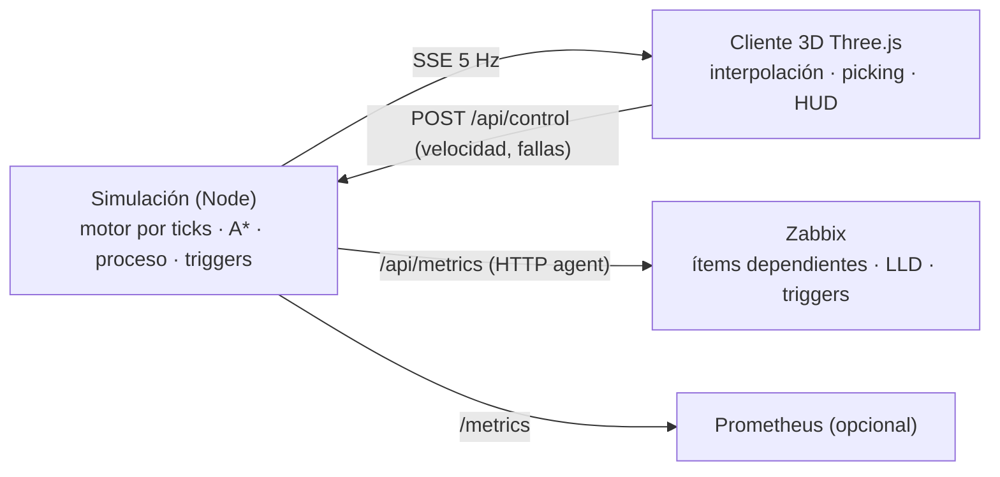

# Zabbix Demo Manufactura — Planta Aceitera 3D

Gemelo digital 3D (Three.js) de una planta de **acopio y molienda de soya**: recepción de camiones por RN4, calado, pesaje, volcadoras, norias, silos y galpones, preparación, **extracción por hexano**, **sala de fuerza** (calderas/vapor), tanques de aceite, galpón de harina y despacho.

La simulación corre en el **servidor** y expone **métricas para Zabbix** (HTTP agent + LLD) y Prometheus. El navegador solo dibuja el estado en vivo.



## Qué se tomó de AI Town

[a16z-infra/ai-town](https://github.com/a16z-infra/ai-town) es en realidad 2D (PixiJS + tilemap), pero su arquitectura sirve tal cual:

| AI Town | Aquí |
|---|---|
| Motor por ticks en el backend (`convex/aiTown/main.ts` → `runStep`) | `js/sim/simulation.js` → `advance()` corre en `server/server.js` cada 200 ms |
| Grilla + A\* con `MinHeap` (`movement.ts` → `findRoute`) | `js/sim/grid.js` (camiones sobre caminos, operarios entre edificios) + desplazamiento al carril derecho |
| Interpolación histórica (`historicalObject.ts`) | `js/net.js` → `SnapshotBuffer`: el cliente dibuja 260 ms en el pasado e interpola |
| Agentes con planes/operaciones | Camiones con plan de etapas y reservas de estaciones; operarios con rondas |
| `PlayerDetails`, `Messages`, `DebugTimeManager` | Panel de detalle con ítems Zabbix, feed de problemas/eventos, control de velocidad |
| Clientes suscritos a Convex | Clientes suscritos por Server-Sent Events (`/api/stream`) |

## Proceso simulado

1. Camión de soya llega por RN4 → portería → playa de espera.
2. **Calador** (humedad, impurezas; ~5 % se rechaza) → **balanza de ingreso**.
3. **Volcadora/tolva** → noria → silos 1–4 (Tolva 1) o silos 5–7 / galpones (Tolva 2).
4. **Balanza de salida** (tara) → sale por RN4.
5. Acopio → silo pulmón → **preparación** → **extractor con hexano** → aceite crudo (~19 %) a tanques, harina (~73 %) al galpón, cascarilla (~6,5 %) a la caldera de biomasa.
6. **Sala de fuerza**: 2 calderas de 25 t/h. Si falta vapor baja la molienda; si el LEL de hexano supera 25 % el interlock detiene el extractor.
7. **Despacho**: cisternas de aceite y camiones de harina (balanza de despacho → carga → balanza de salida).

Fallas aleatorias (y manuales desde el botón **Simular falla**): disparo de caldera, fuga de hexano (LEL), atasco de noria, punto caliente en silo, balanza sin señal. Cada una dispara triggers en Zabbix.

## Endpoints

| Ruta | Uso |
|---|---|
| `/` | Cliente 3D |
| `/api/metrics` | JSON plano para el **ítem maestro HTTP agent** de Zabbix |
| `/api/zabbix/discovery/{silos,tanks,boilers,stations}` | JSON LLD directo |
| `/metrics` | Formato Prometheus (gauges `planta_*`) |
| `/api/state` | Último snapshot completo |
| `/api/stream` | SSE 5 Hz para el cliente |
| `POST /api/control` | `{"speed":5}`, `{"fault":"boiler_trip","target":"B1"}`, `{"clearFaults":true}` |
| `/healthz` | Health check |

Variables de entorno: `PORT` (8080), `SIM_SPEED` (1 = 1 min simulado por segundo), `CONTROL_TOKEN` (si se define, `/api/control` exige el header `x-control-token`; el cliente lo pide una vez).

## Despliegue en Dokploy

1. **Create Service → Application**.
2. Provider **GitHub** → repo `SimonLexRS/Zabbix-Demo-Manufactura`, rama `main`.
3. Build Type: **Dockerfile** (ruta `./Dockerfile`).
4. **Domains**: agrega tu dominio con **Container Port `8080`** (HTTPS opcional con Let's Encrypt).
5. (Opcional) **Environment**: `CONTROL_TOKEN=...` para que nadie más inyecte fallas.
6. **Deploy**. Verifica `https://TU-DOMINIO/healthz`.

No hay dependencias npm: la imagen es `node:20-alpine` + el código. El estado se reinicia en cada despliegue (simulación en memoria).

## Configurar Zabbix (7.0+)

1. **Data collection → Templates → Import** → `zabbix/template_planta_aceitera.yaml`.
2. **Data collection → Hosts → Create host**: nombre `Planta Aceitera`, grupo a elección, template **Planta Aceitera Demo by HTTP** (no requiere interfaz ni agente).
3. En **Macros** del host: `{$PLANTA.URL}` = `https://TU-DOMINIO` (o `http://NOMBRE-SERVICIO:8080` si Zabbix comparte red Docker con la app en Dokploy).
4. En ~1 minuto aparecen los ítems y el descubrimiento crea silos, tanques, calderas y estaciones.

El template trae: 1 ítem maestro (cada `{$PLANTA.INTERVAL}` = 30 s), 42 ítems dependientes, 4 reglas LLD con 14 prototipos, triggers con umbrales en macros (`{$PLANTA.STEAM.MIN}`, `{$PLANTA.LEL.MAX}`, `{$PLANTA.SILO.TEMP.MAX}`, …) y un trigger `nodata` si la planta deja de responder.

En el panel de detalle del cliente 3D cada métrica muestra su **clave de ítem Zabbix** (por ejemplo `planta.silo.level_pct[S1]`, `planta.steam_pressure_bar`), para cruzar la vista 3D con lo que ve Zabbix.

Para regenerar el template después de cambiar métricas: `node tools/gen-zabbix-template.mjs`.

## Estructura

```
index.html, css/            UI (HUD, panel, feed, controles)
js/main.js                  render, cámara, picking, seguimiento, recorrido
js/net.js                   SSE + interpolación (o simulación local si no hay servidor)
js/sim/layout.js            layout de planta (compartido servidor/cliente)
js/sim/grid.js              grilla y A*
js/sim/simulation.js        motor, proceso, camiones, operarios, triggers, métricas
js/world/                   materiales, constructores low-poly, entorno, vista de planta
js/vendor/three/            Three.js r160 (MIT) vendorizado, sin CDN
server/server.js            servidor HTTP + SSE + métricas (sin dependencias)
zabbix/                     template Zabbix 7.0
tools/                      prueba headless de la simulación y generador del template
```

## Desarrollo

```bash
node server/server.js          # http://localhost:8080
node tools/check-sim.mjs 3     # simula 3 días headless y reporta flujos
```

Si se sirve solo el contenido estático (sin el servidor), el cliente detecta la ausencia de `/api/stream` y corre la simulación en el navegador (sin métricas para Zabbix).
