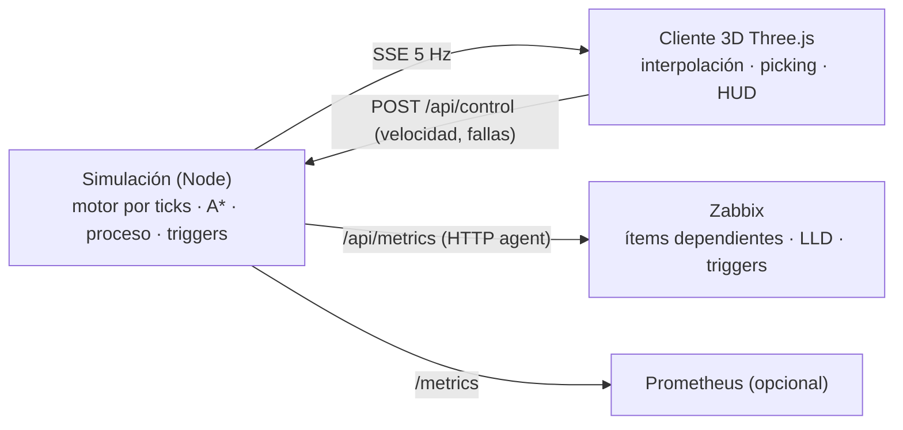

# Zabbix Demo Manufactura — Planta Aceitera 3D

Gemelo digital 3D (Three.js) de una planta de **acopio y molienda de soya**: recepción de camiones por RN4, calado, pesaje, volcadoras, norias, silos y galpones, preparación, **extracción por hexano**, **sala de fuerza** (calderas/vapor), tanques de aceite, galpón de harina y despacho.

La simulación corre en el **servidor** y expone **métricas para Zabbix** (HTTP agent + LLD) y Prometheus. El navegador solo dibuja el estado en vivo.



## Qué se tomó de AI Town

[a16z-infra/ai-town](https://github.com/a16z-infra/ai-town) es en realidad 2D (PixiJS + tilemap), pero su arquitectura sirve tal cual:

| AI Town | Aquí |
|---|---|
| Motor por ticks en el backend (`convex/aiTown/main.ts` → `runStep`) | `js/sim/simulation.js` → `advance()` corre en `server/server.js` cada 200 ms |
| Grilla + A\* con `MinHeap` (`movement.ts` → `findRoute`) | `js/sim/grid.js` (camiones sobre caminos, operarios entre edificios) + desplazamiento al carril derecho |
| Interpolación histórica (`historicalObject.ts`) | `js/net.js` → `SnapshotBuffer`: el cliente dibuja 260 ms en el pasado e interpola |
| Agentes con planes/operaciones | Camiones con plan de etapas y reservas de estaciones; operarios con rondas |
| `PlayerDetails`, `Messages`, `DebugTimeManager` | Panel de detalle con ítems Zabbix, feed de problemas/eventos, control de velocidad |
| Clientes suscritos a Convex | Clientes suscritos por Server-Sent Events (`/api/stream`) |

## Proceso simulado

1. Camión de soya llega por RN4 → portería → playa de espera.
2. **Calador** (humedad, impurezas; ~5 % se rechaza) → **balanza de ingreso**.
3. **Volcadora/tolva** → noria → silos 1–4 (Tolva 1) o silos 5–7 / galpones (Tolva 2).
4. **Balanza de salida** (tara) → sale por RN4.
5. Acopio → silo pulmón → **preparación** → **extractor con hexano** → aceite crudo (~19 %) a tanques, harina (~73 %) al galpón, cascarilla (~6,5 %) a la caldera de biomasa.
6. **Sala de fuerza**: 2 calderas de 25 t/h. Si falta vapor baja la molienda; si el LEL de hexano supera 25 % el interlock detiene el extractor.
7. **Despacho**: cisternas de aceite y camiones de harina (balanza de despacho → carga → balanza de salida).

## Endpoints

| Ruta | Uso |
|---|---|
| `/` | Cliente 3D |
| `/api/metrics` | JSON plano para el **ítem maestro HTTP agent** de Zabbix |
| `/api/zabbix/discovery/{silos,tanks,boilers,stations}` | JSON LLD directo |
| `/metrics` | Formato Prometheus (gauges `planta_*`) |
| `/api/state` | Último snapshot completo |
| `/api/stream` | SSE 5 Hz para el cliente |
| `GET/POST /api/problems` | Puntos problemáticos (ver abajo) |
| `/api/zabbix/status` | Estado del envío con Zabbix sender y del alta automática |
| `POST /api/control` | `{"speed":5}` |
| `GET/PUT /api/config` | Configuración del panel (sin secretos en el GET) |
| `POST /api/zabbix/{test,provision,send-now,correlation}` | Acciones del panel |
| `/healthz` | Health check |

## Problemas: manuales y aleatorios

Botón **Fallas** en la vista 3D (o el panel de cada equipo) con un interruptor por punto problemático:

| id | Problema | Efecto | Severidad |
|---|---|---|---|
| `bal_in_net` | Caída de red en balanza de ingreso | el camión queda **detenido sobre la balanza**, nadie más entra | Alta |
| `bal_out_net` | Caída de red en balanza de salida | camiones detenidos en tara, se llenan las volcadoras | Alta |
| `gate_net` | Portería sin sistema | no ingresan camiones → cola en RN4 | Promedio |
| `samp_fault` | Calador fuera de servicio | la playa se llena | Promedio |
| `boiler_B1` / `boiler_B2` | Disparo de caldera | menos vapor → molienda reducida | Promedio |
| `hexane_leak` | Fuga de hexano | LEL > 25 %, interlock detiene el extractor | Desastre |
| `noria_N1` / `noria_N2` | Atasco de noria | tolva fuera de servicio | Alta |
| `silo_hot_S2` | Punto caliente en Silo 2 | temperatura de grano sube a ~38 °C | Alta |
| `prep_power` | Corte de energía en preparación | molienda = 0 | Alta |
| `ol_arm` | Brazo de carga de aceite bloqueado | cisterna detenida | Promedio |
| `plc_ext_comm` | PLC de extracción sin comunicación | se dejan de enviar sus ítems → `nodata` en Zabbix | Alta |

- **Manual**: queda activo hasta que lo apagues.
- **Aleatorio** (interruptor *Fallas aleatorias*, o `RANDOM_FAULTS=0` para deshabilitar): cada 2–6 h simuladas se activa uno y se resuelve solo en 20–120 min. Si activas a mano uno aleatorio, pasa a manual.
- En Zabbix cada uno es `planta.problem[<id>]` = 0 normal / 1 manual / 2 aleatoria, con su trigger (`last()>0`).

API: `GET /api/problems`, `POST /api/problems` con `{"id":"bal_in_net","active":true}`, `{"randomFaults":false}` o `{"clearAll":true}`.

## Panel de configuración (Zabbix · IoT · CEP · Apariencia)

Botón **Configuración** en la barra inferior. Los cambios se aplican en caliente (sin redeploy) y se guardan en el servidor (`DATA_DIR/config.json`, volumen `planta-data`). Cambiar algo pide la **clave de administrador** (`CONTROL_TOKEN`) una vez por navegador; sin ella se puede mirar la planta pero no cambiar fallas ni configuración.

- **Zabbix**: activar el envío, servidor/puerto trapper, host, grupo, intervalos de envío y de LLD, URL y token de la API (el token nunca se devuelve al navegador), `{$TRAPPER.ALLOWED_HOSTS}`. Botones **Probar conexión** (trapper + API + token), **Re-provisionar** y **Enviar ahora**, con el estado de cada envío.
- **IoT**: 15 dispositivos simulados (termometría de silos S1–S7, radares de nivel TA1–TA3, caudalímetro de aceite, medidores de energía de preparación y sala de fuerza, detector de gas LEL/O₂, estación meteorológica). Cada uno es un **host propio** en Zabbix (`iot-<id>`, grupo `Manufactura/IoT`) con el template **Planta Aceitera IoT device by Zabbix sender**: conexión, batería, RSSI, uptime y sus lecturas por LLD (`iot.metric[...]`). Por dispositivo: habilitar, intervalo, ruido, **Sin conexión** (dispara `nodata`) y **Batería baja**. Con fallas aleatorias activas también hay cortes de radio aleatorios.
- **CEP** (correlación de eventos):
  - **Motor en la app**: reglas "A y B dentro de N minutos" (o "A o B") sobre fallas y métricas. Incluye 5 reglas (red de balanza → camión detenido, pérdida de vapor → molienda, riesgo de seguridad en extracción, cuello de botella en recepción, calidad de grano) y un editor para crear, ajustar ventana/severidad, desactivar o borrar reglas. Cada regla llega a Zabbix como `planta.cep.active[<regla>]` (0 inactiva, 1–5 severidad) con su trigger, más `planta.cep.last_event`.
  - **En Zabbix**: el template sender trae **dependencias de triggers** (p. ej. "camión detenido" depende de "caída de red en balanza"; "molienda < 70 %" de "presión de vapor baja", que depende de los disparos de caldera) y tags `scope` + `rootcause`/`symptom`. Desde el panel se crea la **correlación global** *"Planta Aceitera: la causa raíz cierra los síntomas"* (requiere token Super admin).
- **Apariencia**: render en alta calidad por defecto; modo retro pixelado opcional (se guarda por navegador).

## Envío a Zabbix con Zabbix sender (push)

Con `ZABBIX_SERVER` definido, la app envía **cada `ZABBIX_SEND_INTERVAL` s (10 s)** todos los datos de estado y cantidad (≈170 valores: planta, silos, tanques, calderas, estaciones y problemas) a los **ítems trapper** del host `ZABBIX_HOST`, con el protocolo nativo de Zabbix sender (TCP 10051, cabecera `ZBXD`). Las reglas LLD se envían al arrancar y cada 10 min. Al cambiar un problema se envía al instante. El estado del envío (`processed` / `failed`) se ve en la vista 3D y en `GET /api/zabbix/status`.

**Alta automática**: con `ZABBIX_API_URL` y `ZABBIX_API_TOKEN` la app importa `zabbix/template_planta_aceitera_sender.yaml` (**Planta Aceitera Demo by Zabbix sender**), crea el grupo `Manufactura` y el host `Planta Aceitera` con el template. Reintenta cada 60 s si falla. El token se crea en Zabbix → *User settings → API tokens* (usuario con permiso para importar templates y crear hosts).

**Allowed hosts de los trapper**: Zabbix 8.0 trae la macro global `{$TRAPPER.ALLOWED_HOSTS}` = `127.0.0.1,::1`, que rechaza envíos desde contenedores. El template sender la redefine con las redes privadas de Docker (`10.0.0.0/8,172.16.0.0/12,192.168.0.0/16`); puedes restringirla más en las macros del host.

| Variable | Default | Uso |
|---|---|---|
| `ZABBIX_SERVER` | — (en compose: `zabbix-server`) | Server/proxy que recibe el sender |
| `ZABBIX_PORT` | `10051` | Puerto trapper |
| `ZABBIX_HOST` | `Planta Aceitera` | Nombre técnico del host en Zabbix |
| `ZABBIX_SEND_INTERVAL` | `10` | Segundos entre envíos |
| `ZABBIX_API_URL` | (compose: `http://zabbix-web:8080/api_jsonrpc.php`) | API para el alta automática |
| `ZABBIX_API_TOKEN` | — | Token de API de Zabbix |
| `ZABBIX_HOST_GROUP` | `Manufactura` | Grupo del host |
| `ZABBIX_NETWORK` | `zabbix-testing-lab01-mybwkj_default` | Red Docker del stack de Zabbix (solo compose) |
| `RANDOM_FAULTS` | `1` | `0` = solo fallas manuales |
| `SIM_SPEED` | `1` | 1 min simulado por segundo |
| `CONTROL_TOKEN` | — | Clave de administrador: si se define, los POST/PUT (fallas, configuración) exigen `x-control-token` |
| `DATA_DIR` | `/app/data` | Dónde se guarda la configuración del panel |
| `IOT_ENABLED` | `1` | `0` = no enviar dispositivos IoT |

## Despliegue en Dokploy (Compose, junto al stack de Zabbix)

1. En el proyecto donde corre Zabbix: **Create Service → Compose**, fuente **Git** `https://github.com/SimonLexRS/Zabbix-Demo-Manufactura.git`, rama `main`, ruta `./docker-compose.yml`.
2. **Environment**: `ZABBIX_NETWORK=<appName del compose de Zabbix>_default` y `ZABBIX_API_TOKEN=...` (el resto tiene defaults).
3. **Domains**: servicio `planta`, puerto `8080`.
4. **Deploy** y verifica `https://TU-DOMINIO/healthz` y `https://TU-DOMINIO/api/zabbix/status`.

No hay dependencias npm (`node:20-alpine`). El estado se reinicia en cada despliegue.

## Alternativa: Zabbix por HTTP agent (pull)

`zabbix/template_planta_aceitera.yaml` (**Planta Aceitera Demo by HTTP**) consulta `/api/metrics` con un ítem maestro y dependientes. Usa uno u otro template por host (comparten claves). Macro `{$PLANTA.URL}` = URL de la app.

En el panel de detalle del cliente 3D cada métrica muestra su **clave de ítem Zabbix** (por ejemplo `planta.silo.level_pct[S1]`, `planta.station.network[BAL_IN]`), para cruzar la vista 3D con lo que ve Zabbix.

Para regenerar los templates después de cambiar métricas: `node tools/gen-zabbix-template.mjs`.

## Estructura

```
index.html, css/            UI (HUD, panel, feed, controles)
js/main.js                  render, cámara, picking, seguimiento, recorrido
js/net.js                   SSE + interpolación (o simulación local si no hay servidor)
js/sim/layout.js            layout de planta (compartido servidor/cliente)
js/sim/grid.js              grilla y A*
js/sim/simulation.js        motor, proceso, camiones, operarios, triggers, métricas, ítems sender
js/sim/problems.js          catálogo de puntos problemáticos (manuales / aleatorios)
js/world/                   materiales, constructores low-poly, entorno, vista de planta
js/vendor/three/            Three.js r160 (MIT) vendorizado, sin CDN
server/server.js            servidor HTTP + SSE + métricas (sin dependencias)
server/zabbix-sender.js     protocolo Zabbix sender nativo
server/zabbix-provision.js  alta de template y host por API
docker-compose.yml          despliegue en Dokploy junto al stack de Zabbix
zabbix/                     templates Zabbix (sender y HTTP agent), importables en 7.0 y 8.0
tools/                      prueba headless de la simulación y generador del template
```

## Desarrollo

```bash
node server/server.js          # http://localhost:8080
node tools/check-sim.mjs 3     # simula 3 días headless y reporta flujos
```

Si se sirve solo el contenido estático (sin el servidor), el cliente detecta la ausencia de `/api/stream` y corre la simulación en el navegador (sin métricas para Zabbix).
